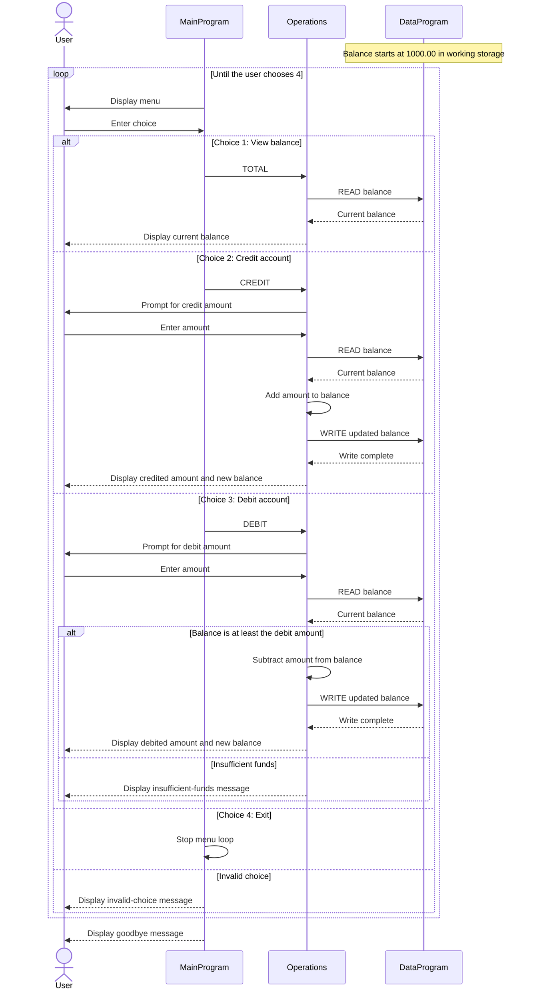

# COBOL Account Management

This directory documents the COBOL account-management example in `src/cobol`. The programs implement a basic menu for viewing and changing one account balance.

## Source Files

### `main.cob` - `MainProgram`

Runs the interactive menu and accepts a choice from the user:

- `1` calls `Operations` with the `TOTAL` operation to display the balance. Its value is space-padded to six characters.
- `2` calls `Operations` with `CREDIT` to add funds.
- `3` calls `Operations` with the `DEBIT` operation to subtract funds. Its value is space-padded to six characters.
- `4` exits the menu loop.

Other choices display an invalid-choice message and return to the menu.

### `operations.cob` - `Operations`

Implements the account actions selected by `MainProgram`:

- **View balance (`TOTAL`):** reads the balance from `DataProgram` and displays it.
- **Credit (`CREDIT`):** accepts an amount, reads the current balance, adds the amount, writes the result, and displays the new balance.
- **Debit (`DEBIT`):** accepts an amount and reads the current balance. If the balance is at least the requested amount, it subtracts and writes the result; otherwise, it displays an insufficient-funds message.

### `data.cob` - `DataProgram`

Provides the balance storage interface. `READ` copies the stored balance to the caller; `WRITE` replaces the stored balance with the caller's value. The stored balance is initialized to `1000.00` and remains in program working storage while the program runs.

## Account Rules and Scope

- The example maintains **one shared balance**, initialized to `1000.00`.
- Credits increase that balance by the entered amount.
- Debits are accepted when the balance is greater than or equal to the entered amount. A debit cannot make the balance negative; an amount greater than the balance is rejected without changing it.
- The programs do not identify individual students or maintain separate student accounts. They also do not save balances beyond the running program, validate amounts for positivity, or apply fees, limits, or other student-specific policies.

These are the rules implemented by the current COBOL programs; student-specific account behavior would require additional data and logic.

## Sequence Diagram

